# Jarkom-Modul-4-2026-K-12

| Nama | NRP |
|---|---|
| Donnavie Aulia | 5027251093 |
| Ndaru Satria Tama | 5027251124 |

Pembagian pengerjaan: **VLSM pada GNS3** (Donnavie Aulia) dan **CIDR pada Cisco Packet Tracer** (_(nama anggota)_).

## Tabel IP Host

Prefix kelompok adalah `192.217`. Seluruh subnet dialokasikan dari blok induk `192.217.0.0/19` menggunakan VLSM.

| Subnet | Node | Peran / Fungsi | Alamat IP | Default Gateway |
|---|---|---|---|---|
| **NAT** | `Cyberia` (`eth0`) | Koneksi WAN ke NAT GNS3 | DHCP (`192.168.122.x/24`) | `192.168.122.1` |
| **A1** (`192.217.14.0/25`) | `Cyberia` (`eth1`) | Router | `192.217.14.1/25` | — |
| A1 | `JJ` | Client / Server | `192.217.14.2/25` | `192.217.14.1` |
| A1 | `MyuMyu` | Client / Server | `192.217.14.3/25` | `192.217.14.1` |
| **A2** (`192.217.16.56/30`) | `Cyberia` (`eth2`) | Router | `192.217.16.57/30` | — |
| A2 | `Wired` (`eth0`) | Router | `192.217.16.58/30` | `192.217.16.57` |
| **A3** (`192.217.16.32/29`) | `Wired` (`eth3`) | Router | `192.217.16.33/29` | — |
| A3 | `Psyche` (`eth0`) | Router | `192.217.16.34/29` | `192.217.16.33` |
| A3 | `Copland` (`eth0`) | Router | `192.217.16.35/29` | `192.217.16.33` |
| A3 | `Schumann` (`eth0`) | Router | `192.217.16.36/29` | `192.217.16.33` |
| **A4** (`192.217.0.0/22`) | `Psyche` (`eth1`) | Router | `192.217.0.1/22` | — |
| A4 | `Karl` | Client / Server | `192.217.0.2/22` | `192.217.0.1` |
| A4 | `Lin` | Client / Server | `192.217.0.3/22` | `192.217.0.1` |
| **A5** (`192.217.15.0/26`) | `Copland` (`eth2`) | Router | `192.217.15.1/26` | — |
| A5 | `Juri` | Client / Server | `192.217.15.2/26` | `192.217.15.1` |
| **A6** (`192.217.8.0/23`) | `Copland` (`eth1`) | Router | `192.217.8.1/23` | — |
| A6 | `Masayuki` | Client / Server | `192.217.8.2/23` | `192.217.8.1` |
| **A7** (`192.217.16.40/29`) | `Schumann` (`eth2`) | Router | `192.217.16.41/29` | — |
| A7 | `Akashic` | Client / Server | `192.217.16.42/29` | `192.217.16.41` |
| **A8** (`192.217.16.60/30`) | `Schumann` (`eth1`) | Router | `192.217.16.61/30` | — |
| A8 | `Accela` (`eth0`) | Router | `192.217.16.62/30` | `192.217.16.61` |
| **A9** (`192.217.4.0/22`) | `Accela` (`eth1`) | Router | `192.217.4.1/22` | — |
| A9 | `Omnipresence` | Client / Server | `192.217.4.2/22` | `192.217.4.1` |
| A9 | `Denpa` | Client / Server | `192.217.4.3/22` | `192.217.4.1` |
| **A10** (`192.217.16.64/30`) | `Wired` (`eth2`) | Router | `192.217.16.65/30` | — |
| A10 | `Navi` (`eth0`) | Router | `192.217.16.66/30` | `192.217.16.65` |
| **A11** (`192.217.12.0/24`) | `Navi` (`eth1`) | Router | `192.217.12.1/24` | — |
| A11 | `Alice` | Client / Server | `192.217.12.2/24` | `192.217.12.1` |
| A11 | `Reika` | Client / Server | `192.217.12.3/24` | `192.217.12.1` |
| **A12** (`192.217.15.64/26`) | `Navi` (`eth2`) | Router | `192.217.15.65/26` | — |
| A12 | `Taro` | Client / Server | `192.217.15.66/26` | `192.217.15.65` |
| **A13** (`192.217.13.0/24`) | `Navi` (`eth3`) | Router | `192.217.13.1/24` | — |
| A13 | `Yasuo` | Client / Server | `192.217.13.2/24` | `192.217.13.1` |
| A13 | `Miho` | Client / Server | `192.217.13.3/24` | `192.217.13.1` |
| A13 | `Kuma` | Client / Server | `192.217.13.4/24` | `192.217.13.1` |
| **A14** (`192.217.16.68/30`) | `Wired` (`eth1`) | Router | `192.217.16.69/30` | — |
| A14 | `Tachibana` (`eth0`) | Router | `192.217.16.70/30` | `192.217.16.69` |
| **A15** (`192.217.10.0/23`) | `Tachibana` (`eth2`) | Router | `192.217.10.1/23` | — |
| A15 | `Collective` | Client / Server | `192.217.10.2/23` | `192.217.10.1` |
| A15 | `Ghost` | Client / Server | `192.217.10.3/23` | `192.217.10.1` |
| **A16** (`192.217.16.72/30`) | `Tachibana` (`eth1`) | Router | `192.217.16.73/30` | — |
| A16 | `Deus` (`eth0`) | Router | `192.217.16.74/30` | `192.217.16.73` |
| **A17** (`192.217.14.128/25`) | `Deus` (`eth2`) | Router | `192.217.14.129/25` | — |
| A17 | `Lilith` | Client / Server | `192.217.14.130/25` | `192.217.14.129` |
| A17 | `Specter` | Client / Server | `192.217.14.131/25` | `192.217.14.129` |
| **A18** (`192.217.16.76/30`) | `Deus` (`eth1`) | Router | `192.217.16.77/30` | — |
| A18 | `Protocol7` (`eth0`) | Router | `192.217.16.78/30` | `192.217.16.77` |
| **A19** (`192.217.15.128/26`) | `Protocol7` (`eth2`) | Router | `192.217.15.129/26` | — |
| A19 | `Chisa` | Client / Server | `192.217.15.130/26` | `192.217.15.129` |
| A19 | `Hodgeson` | Client / Server | `192.217.15.131/26` | `192.217.15.129` |
| **A20** (`192.217.16.80/30`) | `Protocol7` (`eth1`) | Router | `192.217.16.81/30` | — |
| A20 | `Knights` (`eth0`) | Router | `192.217.16.82/30` | `192.217.16.81` |
| **A21** (`192.217.16.48/29`) | `Knights` (`eth2`) | Router | `192.217.16.49/29` | — |
| A21 | `Eiri` | Client / Server | `192.217.16.50/29` | `192.217.16.49` |
| **A22** (`192.217.16.84/30`) | `Knights` (`eth1`) | Router | `192.217.16.85/30` | — |
| A22 | `Phantoma` (`eth0`) | Router | `192.217.16.86/30` | `192.217.16.85` |
| **A23** (`192.217.16.0/27`) | `Phantoma` (`eth2`) | Router | `192.217.16.1/27` | — |
| A23 | `Semi` | Client / Server | `192.217.16.2/27` | `192.217.16.1` |
| **A24** (`192.217.16.88/30`) | `Phantoma` (`eth1`) | Router | `192.217.16.89/30` | — |
| A24 | `Shibuya` (`eth0`) | Router | `192.217.16.90/30` | `192.217.16.89` |
| **A25** (`192.217.15.192/26`) | `Shibuya` (`eth1`) | Router | `192.217.15.193/26` | — |
| A25 | `Lain` | Client / Server | `192.217.15.194/26` | `192.217.15.193` |
| A25 | `Mika` | Client / Server | `192.217.15.195/26` | `192.217.15.193` |

## Topologi

Topologi terdiri dari 13 router, 13 switch, 1 NAT, dan 25 client/server menggunakan image `ardhptr21/debinet` dan `ardhptr21/alpinet`. Router `Cyberia` merupakan satu-satunya router yang terhubung ke NAT.

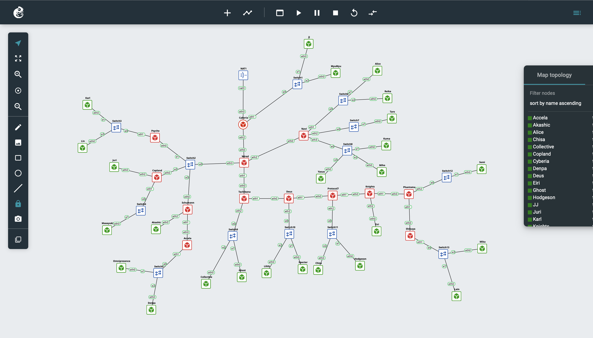

### Peta Interface Router

| Router | eth0 | eth1 | eth2 | eth3 |
|---|---|---|---|---|
| `Cyberia` | NAT1 | Switch1 | Wired | — |
| `Wired` | Cyberia | Tachibana | Navi | Switch2 |
| `Psyche` | Switch2 | Switch3 | — | — |
| `Copland` | Switch2 | Switch4 | Juri | — |
| `Schumann` | Switch2 | Accela | Akashic | — |
| `Accela` | Schumann | Switch5 | — | — |
| `Navi` | Wired | Switch6 | Switch7 | Switch8 |
| `Tachibana` | Wired | Deus | Switch9 | — |
| `Deus` | Tachibana | Protocol7 | Switch10 | — |
| `Protocol7` | Deus | Knights | Switch11 | — |
| `Knights` | Protocol7 | Phantoma | Eiri | — |
| `Phantoma` | Knights | Shibuya | Switch12 | — |
| `Shibuya` | Phantoma | Switch13 | — | — |

## Bagian 1: Perhitungan VLSM

VLSM (*Variable Length Subnet Mask*) membagi satu blok alamat menjadi subnet-subnet dengan ukuran berbeda sesuai kebutuhan masing-masing, sehingga tidak ada alamat yang terbuang.

### Langkah 1: Menghitung kebutuhan IP tiap subnet

Satu subnet adalah semua perangkat yang terhubung melalui kabel/switch yang sama sampai bertemu router. Sesuai ketentuan soal:

```
Total IP = jumlah host + jumlah interface router pada subnet tersebut
```

| Subnet | Keterangan | Host | Interface Router | Total IP |
|---|---|---|---|---|
| **A1** | Cyberia - Switch1 (JJ, MyuMyu) | 125 | 1 | 126 |
| **A2** | Cyberia - Wired | 0 | 2 | 2 |
| **A3** | Wired - Switch2 (Psyche, Copland, Schumann) | 0 | 4 | 4 |
| **A4** | Psyche - Switch3 (Karl, Lin) | 880 | 1 | 881 |
| **A5** | Copland - Juri | 31 | 1 | 32 |
| **A6** | Copland - Switch4 (Masayuki) | 300 | 1 | 301 |
| **A7** | Schumann - Akashic | 3 | 1 | 4 |
| **A8** | Schumann - Accela | 0 | 2 | 2 |
| **A9** | Accela - Switch5 (Omnipresence, Denpa) | 513 | 1 | 514 |
| **A10** | Wired - Navi | 0 | 2 | 2 |
| **A11** | Navi - Switch6 (Alice, Reika) | 253 | 1 | 254 |
| **A12** | Navi - Switch7 (Taro) | 57 | 1 | 58 |
| **A13** | Navi - Switch8 (Yasuo, Miho, Kuma) | 142 | 1 | 143 |
| **A14** | Wired - Tachibana | 0 | 2 | 2 |
| **A15** | Tachibana - Switch9 (Collective, Ghost) | 266 | 1 | 267 |
| **A16** | Tachibana - Deus | 0 | 2 | 2 |
| **A17** | Deus - Switch10 (Lilith, Specter) | 98 | 1 | 99 |
| **A18** | Deus - Protocol7 | 0 | 2 | 2 |
| **A19** | Protocol7 - Switch11 (Chisa, Hodgeson) | 32 | 1 | 33 |
| **A20** | Protocol7 - Knights | 0 | 2 | 2 |
| **A21** | Knights - Eiri | 2 | 1 | 3 |
| **A22** | Knights - Phantoma | 0 | 2 | 2 |
| **A23** | Phantoma - Switch12 (Semi) | 14 | 1 | 15 |
| **A24** | Phantoma - Shibuya | 0 | 2 | 2 |
| **A25** | Shibuya - Switch13 (Lain, Mika) | 61 | 1 | 62 |

> **A3** tidak memiliki host, tetapi terdapat 4 router (`Wired`, `Psyche`, `Copland`, `Schumann`) pada Switch2 sehingga membutuhkan 4 IP. Subnet antar-router hanya berisi 2 interface router.

### Langkah 2: Menentukan prefix tiap subnet

Ukuran blok subnet selalu kelipatan 2ⁿ, dan setiap blok kehilangan 2 alamat untuk **Network ID** dan **Broadcast**. Maka dipilih blok terkecil yang memenuhi:

```
Total IP + 2 <= ukuran blok
ukuran blok  = 2^(32 - prefix)
```

| Prefix | Ukuran Blok | IP Usable | Netmask |
|---|---|---|---|
| `/30` | 4 | 2 | `255.255.255.252` |
| `/29` | 8 | 6 | `255.255.255.248` |
| `/28` | 16 | 14 | `255.255.255.240` |
| `/27` | 32 | 30 | `255.255.255.224` |
| `/26` | 64 | 62 | `255.255.255.192` |
| `/25` | 128 | 126 | `255.255.255.128` |
| `/24` | 256 | 254 | `255.255.255.0` |
| `/23` | 512 | 510 | `255.255.254.0` |
| `/22` | 1024 | 1022 | `255.255.252.0` |

Contoh perhitungan:
1. **A1** membutuhkan 126 IP → 126 + 2 = 128 → blok 128 → `/25`
2. **A5** membutuhkan 32 IP → 32 + 2 = 34 → blok 32 tidak cukup, naik ke 64 → `/26`
3. **A2** membutuhkan 2 IP → 2 + 2 = 4 → blok 4 → `/30`

Total seluruh blok:

```
1024×2 + 512×2 + 256×2 + 128×2 + 64×4 + 32×1 + 8×3 + 4×9 = 4188
```

Karena `/20` hanya menampung 4096 alamat, digunakan blok induk **`192.217.0.0/19`** (8192 alamat).

### Langkah 3: Alokasi alamat IP

Subnet dialokasikan **berurutan dari blok terbesar ke terkecil**, dimulai dari `192.217.0.0`. Setiap subnet dimulai tepat setelah broadcast subnet sebelumnya sehingga tidak ada celah alamat.

| Urutan | Subnet | Total IP | Prefix | Network ID | Netmask | Broadcast | Range IP |
|---|---|---|---|---|---|---|---|
| 1 | **A4** | 881 | `/22` | `192.217.0.0` | `255.255.252.0` | `192.217.3.255` | `192.217.0.1` – `192.217.3.254` |
| 2 | **A9** | 514 | `/22` | `192.217.4.0` | `255.255.252.0` | `192.217.7.255` | `192.217.4.1` – `192.217.7.254` |
| 3 | **A6** | 301 | `/23` | `192.217.8.0` | `255.255.254.0` | `192.217.9.255` | `192.217.8.1` – `192.217.9.254` |
| 4 | **A15** | 267 | `/23` | `192.217.10.0` | `255.255.254.0` | `192.217.11.255` | `192.217.10.1` – `192.217.11.254` |
| 5 | **A11** | 254 | `/24` | `192.217.12.0` | `255.255.255.0` | `192.217.12.255` | `192.217.12.1` – `192.217.12.254` |
| 6 | **A13** | 143 | `/24` | `192.217.13.0` | `255.255.255.0` | `192.217.13.255` | `192.217.13.1` – `192.217.13.254` |
| 7 | **A1** | 126 | `/25` | `192.217.14.0` | `255.255.255.128` | `192.217.14.127` | `192.217.14.1` – `192.217.14.126` |
| 8 | **A17** | 99 | `/25` | `192.217.14.128` | `255.255.255.128` | `192.217.14.255` | `192.217.14.129` – `192.217.14.254` |
| 9 | **A5** | 32 | `/26` | `192.217.15.0` | `255.255.255.192` | `192.217.15.63` | `192.217.15.1` – `192.217.15.62` |
| 10 | **A12** | 58 | `/26` | `192.217.15.64` | `255.255.255.192` | `192.217.15.127` | `192.217.15.65` – `192.217.15.126` |
| 11 | **A19** | 33 | `/26` | `192.217.15.128` | `255.255.255.192` | `192.217.15.191` | `192.217.15.129` – `192.217.15.190` |
| 12 | **A25** | 62 | `/26` | `192.217.15.192` | `255.255.255.192` | `192.217.15.255` | `192.217.15.193` – `192.217.15.254` |
| 13 | **A23** | 15 | `/27` | `192.217.16.0` | `255.255.255.224` | `192.217.16.31` | `192.217.16.1` – `192.217.16.30` |
| 14 | **A3** | 4 | `/29` | `192.217.16.32` | `255.255.255.248` | `192.217.16.39` | `192.217.16.33` – `192.217.16.38` |
| 15 | **A7** | 4 | `/29` | `192.217.16.40` | `255.255.255.248` | `192.217.16.47` | `192.217.16.41` – `192.217.16.46` |
| 16 | **A21** | 3 | `/29` | `192.217.16.48` | `255.255.255.248` | `192.217.16.55` | `192.217.16.49` – `192.217.16.54` |
| 17 | **A2** | 2 | `/30` | `192.217.16.56` | `255.255.255.252` | `192.217.16.59` | `192.217.16.57` – `192.217.16.58` |
| 18 | **A8** | 2 | `/30` | `192.217.16.60` | `255.255.255.252` | `192.217.16.63` | `192.217.16.61` – `192.217.16.62` |
| 19 | **A10** | 2 | `/30` | `192.217.16.64` | `255.255.255.252` | `192.217.16.67` | `192.217.16.65` – `192.217.16.66` |
| 20 | **A14** | 2 | `/30` | `192.217.16.68` | `255.255.255.252` | `192.217.16.71` | `192.217.16.69` – `192.217.16.70` |
| 21 | **A16** | 2 | `/30` | `192.217.16.72` | `255.255.255.252` | `192.217.16.75` | `192.217.16.73` – `192.217.16.74` |
| 22 | **A18** | 2 | `/30` | `192.217.16.76` | `255.255.255.252` | `192.217.16.79` | `192.217.16.77` – `192.217.16.78` |
| 23 | **A20** | 2 | `/30` | `192.217.16.80` | `255.255.255.252` | `192.217.16.83` | `192.217.16.81` – `192.217.16.82` |
| 24 | **A22** | 2 | `/30` | `192.217.16.84` | `255.255.255.252` | `192.217.16.87` | `192.217.16.85` – `192.217.16.86` |
| 25 | **A24** | 2 | `/30` | `192.217.16.88` | `255.255.255.252` | `192.217.16.91` | `192.217.16.89` – `192.217.16.90` |

Seluruh subnet menempati `192.217.0.0` – `192.217.16.91`. Sisa alamat `192.217.16.92` – `192.217.31.255` tidak digunakan.

### Langkah 4: Pohon VLSM

Blok induk `/19` dibelah dua berulang kali sampai ukurannya sesuai kebutuhan tiap subnet.

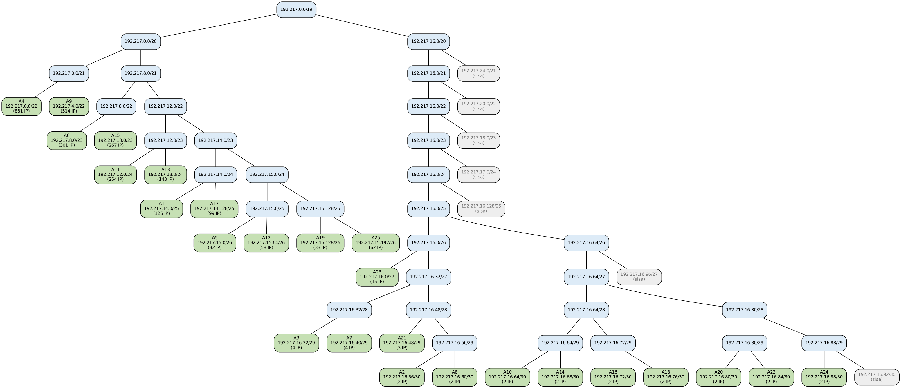

## Bagian 2: Konfigurasi IP pada GNS3

Konfigurasi dimasukkan melalui **klik kanan node → Edit config**, lalu node di-*stop* dan di-*start* ulang. Ketentuan pemberian IP:
1. Interface router mendapat **IP pertama** pada setiap subnet.
2. Client mendapat IP berikutnya secara berurutan.
3. Default gateway client adalah IP interface router pada subnet tersebut.

### Langkah 1: Konfigurasi Cyberia

`Cyberia` mendapat IP dari NAT melalui DHCP, mengaktifkan IP forwarding, dan melakukan MASQUERADE agar seluruh node dapat mengakses internet.

```
auto eth0
iface eth0 inet dhcp
	up echo 1 > /proc/sys/net/ipv4/ip_forward
	up iptables -t nat -A POSTROUTING -o eth0 -j MASQUERADE -s 192.217.0.0/19
	up echo nameserver 192.168.122.1 > /etc/resolv.conf

auto eth1
iface eth1 inet static
	address 192.217.14.1
	netmask 255.255.255.128

auto eth2
iface eth2 inet static
	address 192.217.16.57
	netmask 255.255.255.252
	up ip route add 192.217.0.0/19 via 192.217.16.58
```

### Langkah 2: Konfigurasi router lainnya

**Wired**

```
auto eth0
iface eth0 inet static
	address 192.217.16.58
	netmask 255.255.255.252
	gateway 192.217.16.57
	up echo 1 > /proc/sys/net/ipv4/ip_forward
	up echo nameserver 192.168.122.1 > /etc/resolv.conf

auto eth1
iface eth1 inet static
	address 192.217.16.69
	netmask 255.255.255.252
	up ip route add 192.217.10.0/23 via 192.217.16.70   # A15
	up ip route add 192.217.16.72/30 via 192.217.16.70   # A16
	up ip route add 192.217.14.128/25 via 192.217.16.70   # A17
	up ip route add 192.217.16.76/30 via 192.217.16.70   # A18
	up ip route add 192.217.15.128/26 via 192.217.16.70   # A19
	up ip route add 192.217.16.80/30 via 192.217.16.70   # A20
	up ip route add 192.217.16.48/29 via 192.217.16.70   # A21
	up ip route add 192.217.16.84/30 via 192.217.16.70   # A22
	up ip route add 192.217.16.0/27 via 192.217.16.70   # A23
	up ip route add 192.217.16.88/30 via 192.217.16.70   # A24
	up ip route add 192.217.15.192/26 via 192.217.16.70   # A25

auto eth2
iface eth2 inet static
	address 192.217.16.65
	netmask 255.255.255.252
	up ip route add 192.217.12.0/24 via 192.217.16.66   # A11
	up ip route add 192.217.15.64/26 via 192.217.16.66   # A12
	up ip route add 192.217.13.0/24 via 192.217.16.66   # A13

auto eth3
iface eth3 inet static
	address 192.217.16.33
	netmask 255.255.255.248
	up ip route add 192.217.0.0/22 via 192.217.16.34   # A4
	up ip route add 192.217.15.0/26 via 192.217.16.35   # A5
	up ip route add 192.217.8.0/23 via 192.217.16.35   # A6
	up ip route add 192.217.16.40/29 via 192.217.16.36   # A7
	up ip route add 192.217.16.60/30 via 192.217.16.36   # A8
	up ip route add 192.217.4.0/22 via 192.217.16.36   # A9
```

**Psyche**

```
auto eth0
iface eth0 inet static
	address 192.217.16.34
	netmask 255.255.255.248
	gateway 192.217.16.33
	up echo 1 > /proc/sys/net/ipv4/ip_forward
	up echo nameserver 192.168.122.1 > /etc/resolv.conf

auto eth1
iface eth1 inet static
	address 192.217.0.1
	netmask 255.255.252.0
```

**Copland**

```
auto eth0
iface eth0 inet static
	address 192.217.16.35
	netmask 255.255.255.248
	gateway 192.217.16.33
	up echo 1 > /proc/sys/net/ipv4/ip_forward
	up echo nameserver 192.168.122.1 > /etc/resolv.conf

auto eth1
iface eth1 inet static
	address 192.217.8.1
	netmask 255.255.254.0

auto eth2
iface eth2 inet static
	address 192.217.15.1
	netmask 255.255.255.192
```

**Schumann**

```
auto eth0
iface eth0 inet static
	address 192.217.16.36
	netmask 255.255.255.248
	gateway 192.217.16.33
	up echo 1 > /proc/sys/net/ipv4/ip_forward
	up echo nameserver 192.168.122.1 > /etc/resolv.conf

auto eth1
iface eth1 inet static
	address 192.217.16.61
	netmask 255.255.255.252
	up ip route add 192.217.4.0/22 via 192.217.16.62   # A9

auto eth2
iface eth2 inet static
	address 192.217.16.41
	netmask 255.255.255.248
```

**Accela**

```
auto eth0
iface eth0 inet static
	address 192.217.16.62
	netmask 255.255.255.252
	gateway 192.217.16.61
	up echo 1 > /proc/sys/net/ipv4/ip_forward
	up echo nameserver 192.168.122.1 > /etc/resolv.conf

auto eth1
iface eth1 inet static
	address 192.217.4.1
	netmask 255.255.252.0
```

**Navi**

```
auto eth0
iface eth0 inet static
	address 192.217.16.66
	netmask 255.255.255.252
	gateway 192.217.16.65
	up echo 1 > /proc/sys/net/ipv4/ip_forward
	up echo nameserver 192.168.122.1 > /etc/resolv.conf

auto eth1
iface eth1 inet static
	address 192.217.12.1
	netmask 255.255.255.0

auto eth2
iface eth2 inet static
	address 192.217.15.65
	netmask 255.255.255.192

auto eth3
iface eth3 inet static
	address 192.217.13.1
	netmask 255.255.255.0
```

**Tachibana**

```
auto eth0
iface eth0 inet static
	address 192.217.16.70
	netmask 255.255.255.252
	gateway 192.217.16.69
	up echo 1 > /proc/sys/net/ipv4/ip_forward
	up echo nameserver 192.168.122.1 > /etc/resolv.conf

auto eth1
iface eth1 inet static
	address 192.217.16.73
	netmask 255.255.255.252
	up ip route add 192.217.14.128/25 via 192.217.16.74   # A17
	up ip route add 192.217.16.76/30 via 192.217.16.74   # A18
	up ip route add 192.217.15.128/26 via 192.217.16.74   # A19
	up ip route add 192.217.16.80/30 via 192.217.16.74   # A20
	up ip route add 192.217.16.48/29 via 192.217.16.74   # A21
	up ip route add 192.217.16.84/30 via 192.217.16.74   # A22
	up ip route add 192.217.16.0/27 via 192.217.16.74   # A23
	up ip route add 192.217.16.88/30 via 192.217.16.74   # A24
	up ip route add 192.217.15.192/26 via 192.217.16.74   # A25

auto eth2
iface eth2 inet static
	address 192.217.10.1
	netmask 255.255.254.0
```

**Deus**

```
auto eth0
iface eth0 inet static
	address 192.217.16.74
	netmask 255.255.255.252
	gateway 192.217.16.73
	up echo 1 > /proc/sys/net/ipv4/ip_forward
	up echo nameserver 192.168.122.1 > /etc/resolv.conf

auto eth1
iface eth1 inet static
	address 192.217.16.77
	netmask 255.255.255.252
	up ip route add 192.217.15.128/26 via 192.217.16.78   # A19
	up ip route add 192.217.16.80/30 via 192.217.16.78   # A20
	up ip route add 192.217.16.48/29 via 192.217.16.78   # A21
	up ip route add 192.217.16.84/30 via 192.217.16.78   # A22
	up ip route add 192.217.16.0/27 via 192.217.16.78   # A23
	up ip route add 192.217.16.88/30 via 192.217.16.78   # A24
	up ip route add 192.217.15.192/26 via 192.217.16.78   # A25

auto eth2
iface eth2 inet static
	address 192.217.14.129
	netmask 255.255.255.128
```

**Protocol7**

```
auto eth0
iface eth0 inet static
	address 192.217.16.78
	netmask 255.255.255.252
	gateway 192.217.16.77
	up echo 1 > /proc/sys/net/ipv4/ip_forward
	up echo nameserver 192.168.122.1 > /etc/resolv.conf

auto eth1
iface eth1 inet static
	address 192.217.16.81
	netmask 255.255.255.252
	up ip route add 192.217.16.48/29 via 192.217.16.82   # A21
	up ip route add 192.217.16.84/30 via 192.217.16.82   # A22
	up ip route add 192.217.16.0/27 via 192.217.16.82   # A23
	up ip route add 192.217.16.88/30 via 192.217.16.82   # A24
	up ip route add 192.217.15.192/26 via 192.217.16.82   # A25

auto eth2
iface eth2 inet static
	address 192.217.15.129
	netmask 255.255.255.192
```

**Knights**

```
auto eth0
iface eth0 inet static
	address 192.217.16.82
	netmask 255.255.255.252
	gateway 192.217.16.81
	up echo 1 > /proc/sys/net/ipv4/ip_forward
	up echo nameserver 192.168.122.1 > /etc/resolv.conf

auto eth1
iface eth1 inet static
	address 192.217.16.85
	netmask 255.255.255.252
	up ip route add 192.217.16.0/27 via 192.217.16.86   # A23
	up ip route add 192.217.16.88/30 via 192.217.16.86   # A24
	up ip route add 192.217.15.192/26 via 192.217.16.86   # A25

auto eth2
iface eth2 inet static
	address 192.217.16.49
	netmask 255.255.255.248
```

**Phantoma**

```
auto eth0
iface eth0 inet static
	address 192.217.16.86
	netmask 255.255.255.252
	gateway 192.217.16.85
	up echo 1 > /proc/sys/net/ipv4/ip_forward
	up echo nameserver 192.168.122.1 > /etc/resolv.conf

auto eth1
iface eth1 inet static
	address 192.217.16.89
	netmask 255.255.255.252
	up ip route add 192.217.15.192/26 via 192.217.16.90   # A25

auto eth2
iface eth2 inet static
	address 192.217.16.1
	netmask 255.255.255.224
```

**Shibuya**

```
auto eth0
iface eth0 inet static
	address 192.217.16.90
	netmask 255.255.255.252
	gateway 192.217.16.89
	up echo 1 > /proc/sys/net/ipv4/ip_forward
	up echo nameserver 192.168.122.1 > /etc/resolv.conf

auto eth1
iface eth1 inet static
	address 192.217.15.193
	netmask 255.255.255.192
```

### Langkah 3: Konfigurasi client / server

Seluruh client menggunakan format yang sama. Alamat IP, netmask, dan gateway tiap client mengikuti **Tabel IP Host**. Contoh untuk `JJ`:

```
auto eth0
iface eth0 inet static
	address 192.217.14.2
	netmask 255.255.255.128
	gateway 192.217.14.1
	up echo nameserver 192.168.122.1 > /etc/resolv.conf
```

### Langkah 4: Pengujian di node Cyberia

1. Cek IP tiap interface:

   ```
   ip a
   ```

   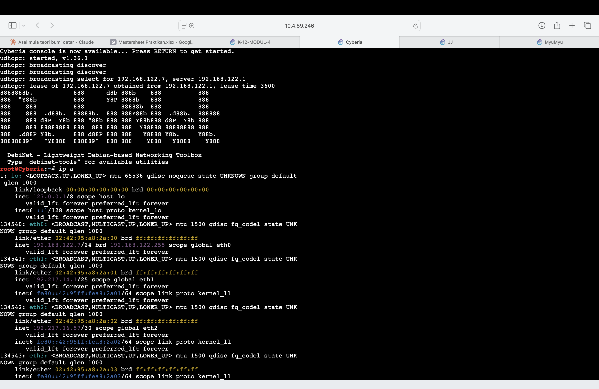

2. Cek koneksi internet:

   ```
   ping -c 3 google.com
   ```

   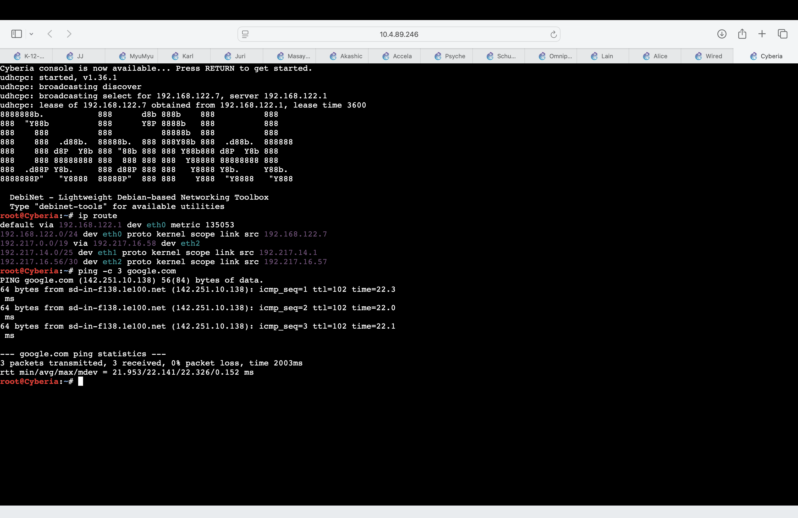

## Bagian 3: Routing

### Langkah 1: Menentukan static route

Routing menggunakan **static route** dengan prinsip seefisien mungkin:
1. Setiap router memiliki **default route** (`gateway`) ke router di atasnya menuju `Cyberia`. `Cyberia` menggunakan default route dari NAT.
2. **Static route** hanya dipasang pada router yang memiliki subnet lain di bawahnya yang tidak terhubung langsung.
3. Router ujung (`Psyche`, `Copland`, `Accela`, `Navi`, `Shibuya`) cukup menggunakan default route.
4. `Cyberia` cukup menggunakan **satu route ringkasan** `192.217.0.0/19 via Wired`. Subnet yang terhubung langsung ke `Cyberia` (A1, A2) tetap dipilih lebih dulu karena prefix-nya lebih spesifik (*longest prefix match*).

| Router | Jumlah Static Route | Tujuan |
|---|---|---|
| `Cyberia` | 1 | `192.217.0.0/19` via `Wired` |
| `Wired` | 20 | 6 subnet via `Psyche`/`Copland`/`Schumann`, 3 via `Navi`, 11 via `Tachibana` |
| `Schumann` | 1 | A9 via `Accela` |
| `Tachibana` | 9 | A17–A25 via `Deus` |
| `Deus` | 7 | A19–A25 via `Protocol7` |
| `Protocol7` | 5 | A21–A25 via `Knights` |
| `Knights` | 3 | A23–A25 via `Phantoma` |
| `Phantoma` | 1 | A25 via `Shibuya` |
| `Psyche`, `Copland`, `Accela`, `Navi`, `Shibuya` | 0 | Default route saja |

Static route ditulis sebagai baris `up ip route add ...` pada konfigurasi router di **Bagian 2**, sehingga otomatis terpasang setiap node dinyalakan.

### Langkah 2: Pengujian routing table

1. Routing table `Wired`:

   ```
   ip route
   ```

   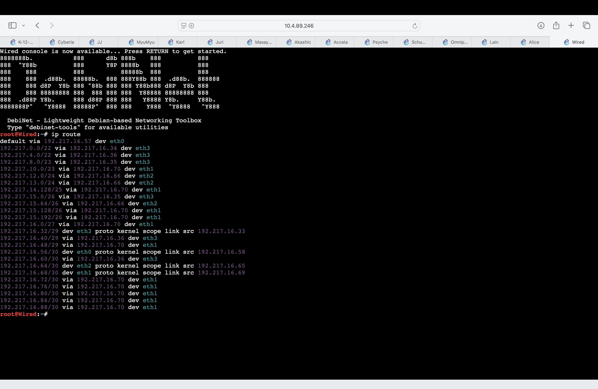

2. Routing table `Cyberia`:

   ```
   ip route
   ```

   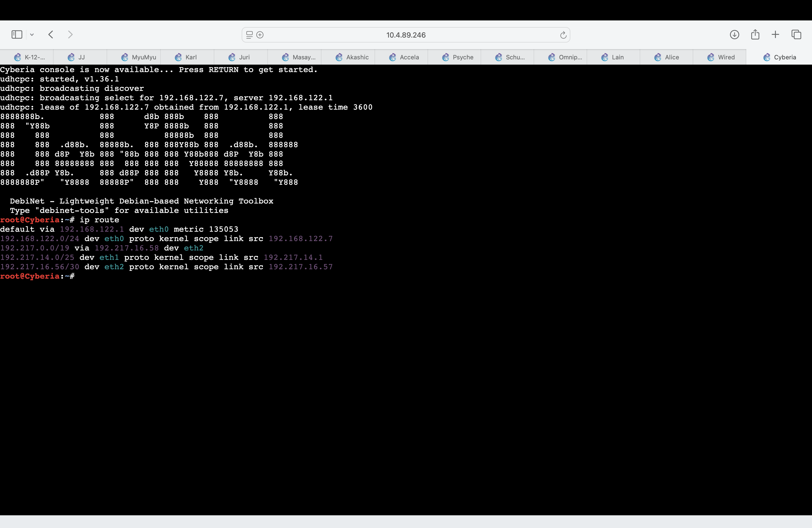

   Terlihat route `192.217.0.0/19 via 192.217.16.58 dev eth2`.

## Bagian 4: Pengujian Konektivitas

1. Node terdalam (`Lain`) ke ujung lain (`Karl`) dan internet:

   ```
   ping -c 3 192.217.0.2
   ping -c 3 google.com
   ```

   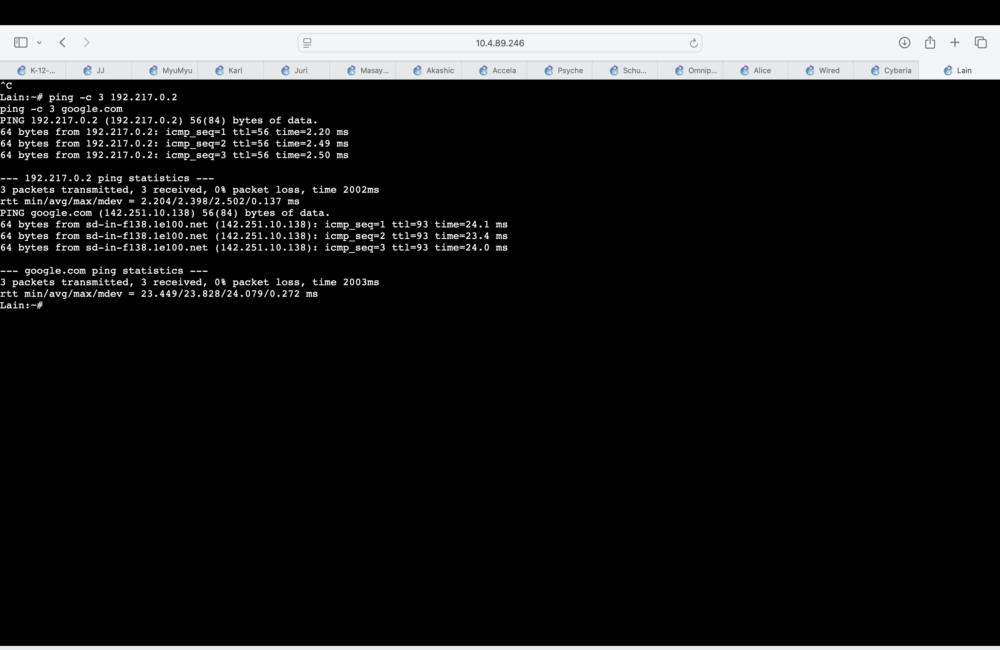

   Nilai `ttl=56` menunjukkan paket melewati 8 router (64 − 56).

2. Traceroute dari `Lain` ke `Karl`:

   ```
   traceroute -n 192.217.0.2
   ```

   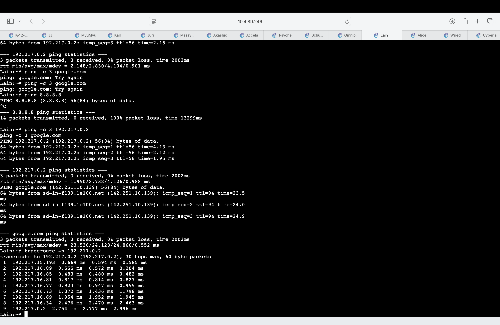

   Paket melewati `Shibuya` → `Phantoma` → `Knights` → `Protocol7` → `Deus` → `Tachibana` → `Wired` → `Psyche` → `Karl`. Seluruh hop berada di jaringan `192.217.x.x` dan tidak melewati NAT.

3. `JJ` ke `Eiri`:

   ```
   ping -c 3 192.217.16.50
   ```

   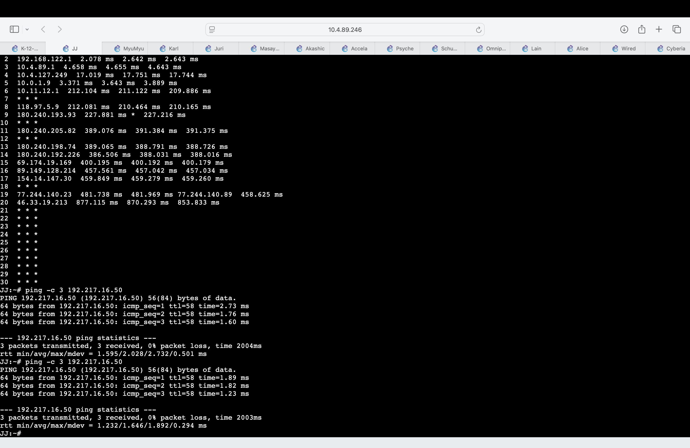

4. `Omnipresence` ke `Kuma`:

   ```
   ping -c 3 192.217.13.4
   ```

   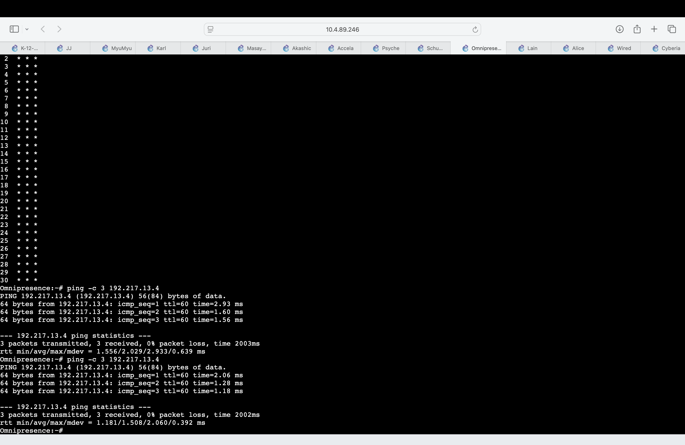

5. `Karl` ke `Psyche`, `Lin`, dan `Semi`:

   ```
   ping -c 3 192.217.0.1
   ping -c 3 192.217.0.3
   ping -c 3 192.217.16.2
   ```

   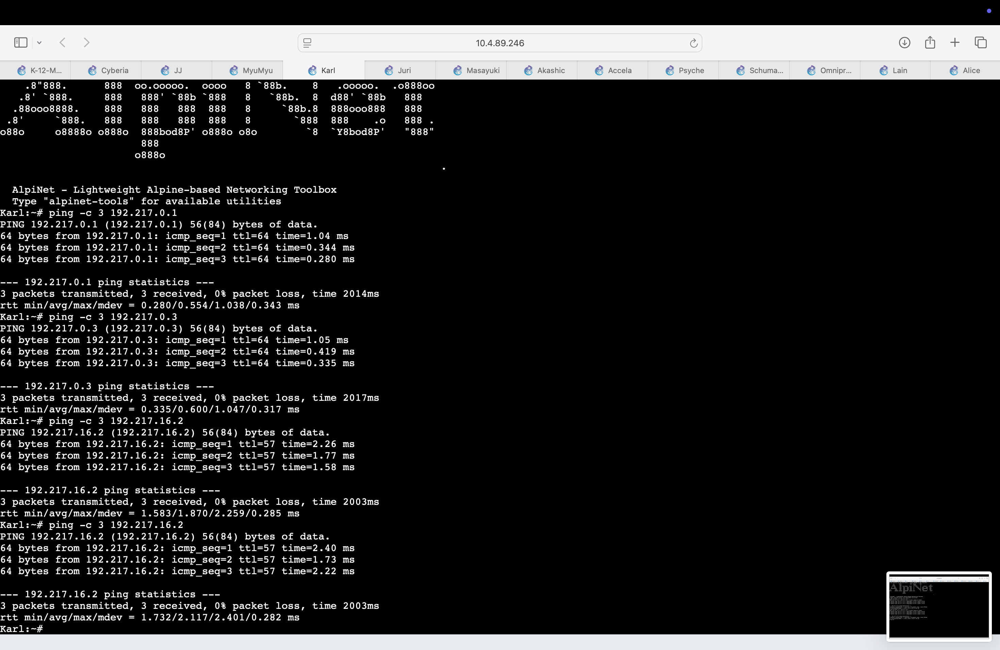

6. `Alice` ke `Collective`:

   ```
   ping -c 3 192.217.10.2
   ```

   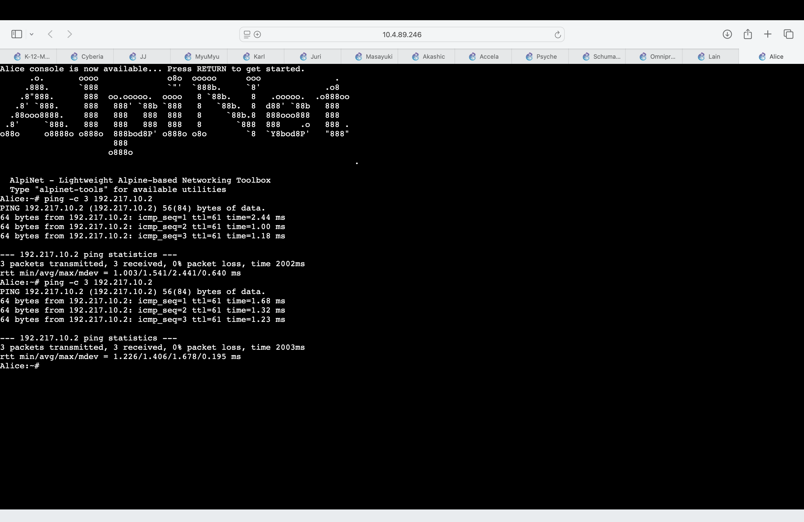

## Kendala

1. **Konfigurasi node tidak tersimpan.** Beberapa node (`Wired`, `Schumann`, `Omnipresence`) tidak mendapat IP setelah restart karena isi *Edit config* belum tersimpan. Diatasi dengan membuka ulang *Edit config*, memastikan isinya tersimpan, lalu *stop* dan *start* node.
2. **Static route tidak terpasang.** Beberapa router masih menggunakan konfigurasi lama tanpa baris `up ip route add`, sehingga `ip route` tidak menampilkan static route. Diatasi dengan menimpa ulang konfigurasi router dan memverifikasi jumlah route dengan `ip route | grep -c via`.
3. **Paket `192.217.x.x` keluar ke internet.** Sebelum route ringkasan dipasang di `Cyberia`, traceroute menunjukkan paket diteruskan ke `192.168.122.1` (NAT) karena `Cyberia` menganggap `192.217.x.x` sebagai alamat publik. Setelah route `192.217.0.0/19 via 192.217.16.58` ditambahkan, paket diarahkan ke `Wired`.
